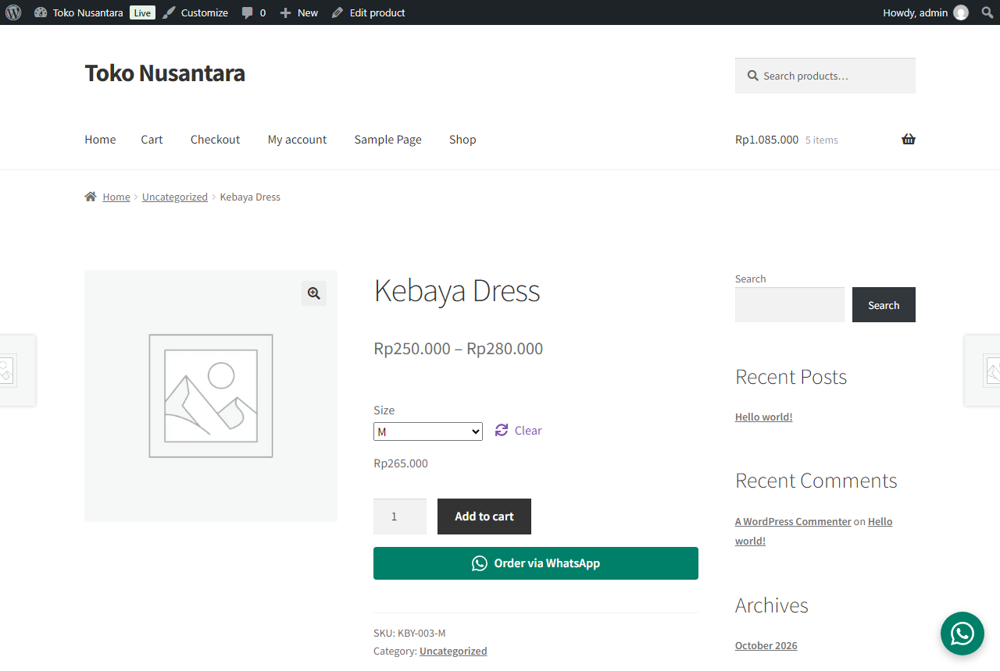

# Order on WhatsApp for WooCommerce

A WordPress plugin that lets shoppers send an order to the store's WhatsApp number with the message already written: product, chosen options, quantity, price and link. It also sends a whole cart in one message.

Built for small shops that still close most sales in WhatsApp chats.



Message sent when the shopper picks size M and quantity 2:

```
Hello, I'd like to order:
*Kebaya Dress (Size: M)*
Quantity: 2
Price: Rp265.000
Subtotal: Rp530.000
https://example.com/product/kebaya-dress/
```

Message from the cart button:

```
Hello, I'd like to order these items:
- Kebaya Dress (Size: M) x 2 = Rp530.000
- Batik Parang Shirt x 3 = Rp555.000

*Total: Rp1.085.000*
```

## Features

- **Product page button** under "Add to cart". The message updates live when the shopper changes the quantity or picks a variation (size, color).
- **Shop page button** for simple products (optional).
- **Cart button** that sends every item and the total. It reads the current cart from the WooCommerce Store API on click, so it works on both the classic cart and the block-based Cart page.
- **Floating chat button** on every page, bottom left or right.
- **Shortcode** `[order_on_whatsapp]` for landing pages and posts.
- **Settings page** with editable message templates and placeholders.
- Prices follow the store's currency settings (symbol, separators, decimals), e.g. `Rp185.000` or `₹1,499.00`.

## How it works

| Part | WordPress / WooCommerce API used |
| --- | --- |
| Settings page | Settings API (`register_setting`, `add_settings_section`, `add_settings_field`) with a sanitize callback and admin notices for invalid numbers |
| Product button | `woocommerce_after_add_to_cart_button` hook; JS listens to WooCommerce's `found_variation` / `reset_data` events |
| Shop button | `woocommerce_after_shop_loop_item` hook |
| Cart button | `woocommerce_proceed_to_checkout` (classic cart) and `render_block_woocommerce/proceed-to-checkout-block` (Cart block); message built from `GET /wp-json/wc/store/v1/cart` |
| Floating button | `wp_footer` |
| Shortcode | `add_shortcode` + `shortcode_atts` |
| Compatibility | Declares HPOS and Cart/Checkout blocks support via `FeaturesUtil::declare_compatibility` |
| Cleanup | `uninstall.php` removes the saved option |

Security: every value is sanitized on save (`sanitize_text_field`, `sanitize_textarea_field`, digits-only phone) and escaped on output (`esc_url`, `esc_attr`, `esc_html`, `wp_kses`). The settings page checks `manage_options`.

Accessibility: button colors meet WCAG AA contrast, the floating button has an `aria-label`, focus outlines are visible, and animations respect `prefers-reduced-motion`.

### Notes from testing

- `esc_url()` strips encoded line breaks (`%0A`), which flattened the message into one line. The wa.me link is built from a fixed host, a digits-only number and `rawurlencode()` output, so it is escaped with `esc_attr()` instead (see `wa_href()`).
- An invalid number (leading `0`, wrong length) shows an admin error and keeps the last good number, so the buttons never break.
- The shortcode ignores draft and private products, because Contributors can place shortcodes (found with a security audit).
- On phones, Storefront shows a fixed toolbar at the bottom. The floating button moves above it using the `--oow-floating-bottom` CSS variable.

### Tested on

| Theme | Product page | Shop page | Classic cart | Cart block |
| --- | --- | --- | --- | --- |
| Storefront (classic) | ✓ | ✓ | ✓ | ✓ |
| Twenty Twenty-Five (block) | ✓ | ✓ | – | ✓ |

WordPress latest, WooCommerce latest, PHP 8.3, via WordPress Playground.

## Project structure

```
order-on-whatsapp/
├── order-on-whatsapp.php        Plugin header and bootstrap
├── includes/
│   ├── class-oow-settings.php   Settings page (Settings API)
│   └── class-oow-frontend.php   Buttons, shortcode, assets
├── assets/
│   ├── css/oow.css
│   └── js/oow.js                Live message updates + cart via Store API
├── blueprint.json               One-command demo store (WordPress Playground)
├── screenshots/
├── uninstall.php
└── readme.txt                   WordPress.org format
```

## Run the demo locally

Needs Node.js 20+. From this folder:

```bash
npx @wp-playground/cli@3.1.54 server --auto-mount --blueprint=blueprint.json
```

This starts WordPress at http://127.0.0.1:9400 with WooCommerce, the Storefront theme, three sample products priced in Rupiah, and the plugin active. You are logged in as admin.

## Install on a real site

1. Zip the `order-on-whatsapp` folder and upload it in **Plugins > Add New > Upload Plugin**, then activate.
2. Open **Settings > Order on WhatsApp** and enter the number with the country code, without `+` or a leading `0` (e.g. `6281234567890`).

## Message placeholders

| Message | Placeholders |
| --- | --- |
| Product | `{product}` `{qty}` `{price}` `{subtotal}` `{sku}` `{url}` |
| Cart | `{items}` `{count}` `{total}` |

WhatsApp formatting works in templates, e.g. `*bold*`.

## License

GPL-2.0-or-later
